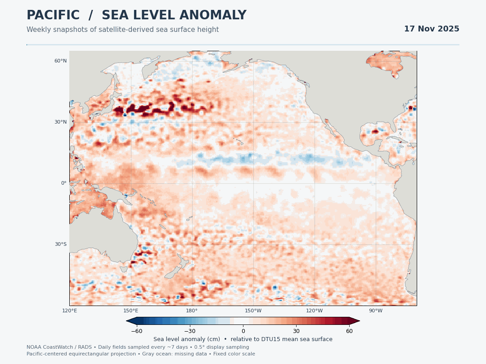
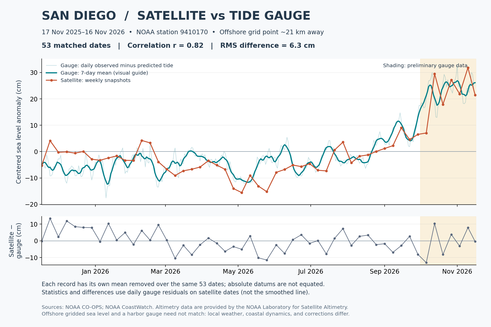

# Pacific sea level anomaly

Weekly satellite-derived sea-level anomaly across the Pacific from November 17, 2025 through November 16, 2026. Colors show anomaly relative to NOAA's DTU15 mean sea surface: red is higher, blue is lower.

[Download the MP4 animation](pacific_sla/pacific_sea_level_anomaly.mp4) · [Pacific dataset, methods, and reproduction notes](pacific_sla/README.md)

## San Diego comparison

The nearest consistently valid animation grid point is about 21 km offshore from NOAA tide gauge 9410170 in San Diego. The comparison removes predicted tides from the gauge record and centers both records before comparing their variation. Across 53 matched dates, correlation is 0.82 and centered RMS difference is 6.3 cm. The October–November gauge data are preliminary.

[Detailed methods, data limits, and source links](san_diego_comparison/README.md) · [Matched comparison data](san_diego_comparison/paired_comparison.csv) · [PDF figure](san_diego_comparison/san_diego_comparison.pdf)

## Contents

- `pacific_sla/` contains the animation, weekly NetCDF source subsets, provenance, and rendering code.
- `san_diego_comparison/` contains NOAA gauge downloads, processed data, statistics, figure, and comparison code.

The data are NOAA CoastWatch satellite altimetry and NOAA CO-OPS gauge observations. This project describes observed anomaly variability; it is not a coastal flood forecast or a sea-level trend estimate.
